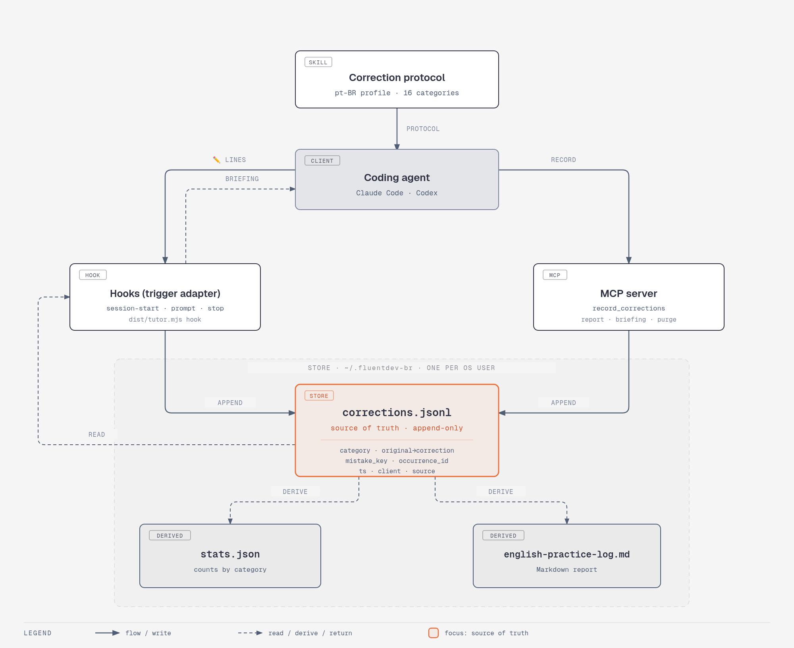

# FluentDev-BR

An [Agent Plugins 1.0.0](https://agent-plugins.org/specification) plugin that gives your coding agent the added ability to also act as an English tutor, without removing any of its coding abilities. By analyzing the messages you write, it corrects your English, records the mistakes you repeat and reviews them with you. It is tuned for Brazilian Portuguese speakers and builds on [Luna's Claude Code hooks setup](https://blog.stackademic.com/turning-my-coding-tool-into-an-english-tutor-with-claude-code-hooks-de3384f09b7f).

MVP clients: Claude Code and Codex. Post-MVP: Antigravity CLI.

## Install

Two commands per client. Both add this repository as a plugin marketplace, then install the plugin from it.

### Claude Code

```sh
claude plugin marketplace add felipe-NR/FluentDev-BR
claude plugin install fluentdev-br@fluentdev-br
```

The plugin brings the `fluentdev-br` skill, the MCP server and the hooks that trigger the tutor on every message. Node.js 22 or later must be on the PATH.

### Codex

```sh
codex plugin marketplace add felipe-NR/FluentDev-BR
codex plugin add fluentdev-br@fluentdev-br
```

Codex loads the skill and the MCP server from this package but ignores its hooks, so the message trigger ships as a legacy package under `adapters/codex/` that the same marketplace installs. Codex asks you to trust the plugin's hooks on install; approve it, or the tutor stays silent. In non-interactive `codex exec` runs, hooks are skipped unless you pass `--dangerously-bypass-hook-trust`. See [docs/compatibility.md](docs/compatibility.md) for the client behavior this relies on.

### Antigravity CLI

```sh
agy plugin install https://github.com/felipe-NR/FluentDev-BR/tree/main/adapters/antigravity
```

Antigravity CLI loads hooks from `hooks.json` at the plugin root and MCP servers from `mcp_config.json`, which ships as a native package under `adapters/antigravity/` (ADR-0003). In non-interactive `agy -p` runs, tool calls require `--dangerously-skip-permissions`. See [docs/compatibility.md](docs/compatibility.md) for details.

### Update

Installs stay pinned to the version they were fetched at; they do not auto-update. To move an existing install to the latest release, refresh the marketplace, then update the plugin. Your stored correction history and preferences live in the per-OS-user data store, outside the package, so an update leaves them untouched.

Claude Code (restart to apply):

```sh
claude plugin marketplace update fluentdev-br
claude plugin update fluentdev-br
```

Codex:

```sh
codex plugin marketplace update fluentdev-br
codex plugin add fluentdev-br@fluentdev-br
```

Antigravity CLI:

```sh
agy plugin update fluentdev-br
```

## Status

Phases 0 (foundation), 1 (client verification), 2 (portable core), 3 (trigger adapters), 4 (packaging and distribution) and 5 (hardening) of the [implementation plan](docs/implementation-plan.md) (pt-BR) are complete, which closes the MVP. This is release `0.2.0`. Active work is in [docs/tasks.md](docs/tasks.md).

## Design

- `plugin/` is the portable Agent Plugins package: a skill, an MCP server and the bundled `tutor` CLI.
- Per-client hooks trigger the tutor on every message where the client supports it.



[ADR-0001](docs/adr/0001-tutor-layers.md) explains the split, and [docs/architecture.md](docs/architecture.md) describes the current architecture. The diagram source is [`docs/diagrams/fluentdev-br-architecture-en.html`](docs/diagrams/fluentdev-br-architecture-en.html) (and `.svg`).

## Development

Development requires Node.js 24 (see `.nvmrc`). The bundled CLI runs on Node.js 22 or later.

```sh
npm ci
npm run check   # lint, typecheck, tests, plugin conformance, bundle freshness
npm run build   # rebuild plugin/dist/tutor.mjs, adapters/codex/ and adapters/antigravity/ after changing src/
```

`plugin/dist/tutor.mjs` and the generated `adapters/codex/` and `adapters/antigravity/` are committed because installs from git run no build step, and CI checks both stay in sync with the sources. Rules for contributors and coding agents live in [AGENTS.md](AGENTS.md).

## Documentation

[AGENTS.md](AGENTS.md) routes reading: which document is the source of truth for each subject, and which one to read for a task.

- [docs/product.md](docs/product.md): what the plugin adds to a coding agent, for whom, and its scope
- [docs/architecture.md](docs/architecture.md): current architecture
- [docs/adr/](docs/adr/README.md): decisions and their status
- [docs/compatibility.md](docs/compatibility.md): verified client behavior
- [docs/risks.md](docs/risks.md): risks and mitigations
- [docs/tasks.md](docs/tasks.md): active work
- [docs/backlog.md](docs/backlog.md): possibilities after the MVP
- [docs/implementation-plan.md](docs/implementation-plan.md): history of the initial plan and of Phases 0 to 5 (pt-BR)

## Em português

O FluentDev-BR é um plugin que acrescenta ao agente de código a capacidade de também atuar como professor/tutor de inglês para brasileiros, através da análise dos inputs do usuário, sem remover nenhuma das capacidades que o agente já tem. Ele corrige o inglês das mensagens enviadas ao agente e acompanha os erros que se repetem. Instale com dois comandos por cliente (veja **Install** acima): no Claude Code, `claude plugin marketplace add felipe-NR/FluentDev-BR` e depois `claude plugin install fluentdev-br@fluentdev-br`; no Codex, os mesmos passos com `codex`; no Antigravity CLI, `agy plugin install https://github.com/felipe-NR/FluentDev-BR/tree/main/adapters/antigravity`. Esta é a versão `0.2.0`. O [plano de implementação](docs/implementation-plan.md), registro histórico do MVP, está em português, e o [diagrama de arquitetura](docs/diagrams/fluentdev-br-arquitetura.png) também tem versão em português.

## License

[MIT](LICENSE)
